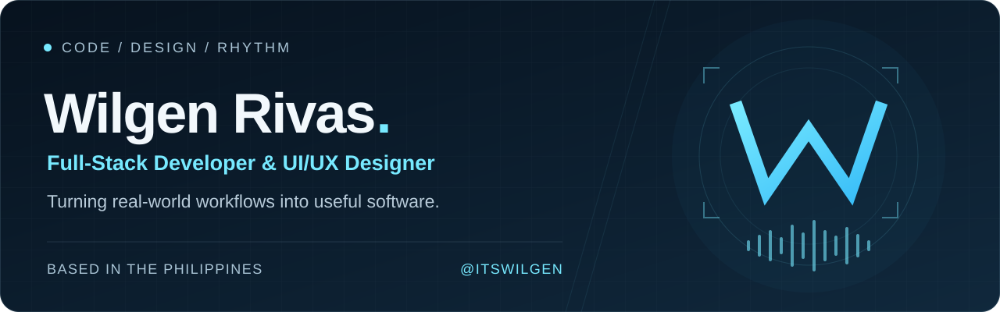

  

  <a href="https://github.com/itswilgen?tab=repositories">Explore my projects</a>
  &nbsp; · &nbsp;
  <a href="https://github.com/itswilgen/MyPortfolio">Portfolio source</a>
  &nbsp; · &nbsp;
  <a href="https://www.instagram.com/wilgen_thedj/">Connect on Instagram</a>

## Building useful software, with thoughtful design.

I'm **Wilgen Rivas**, a full-stack developer and UI/UX designer from the Philippines. I build web applications for real-world workflows, including inventory, point-of-sale, and management systems. I care about clear interfaces, maintainable code, and making everyday tasks easier.

- **Studying:** BS Information Technology at NORSU – Bais Campus.
- **Focused on:** full-stack web development, database design, and responsive interfaces.
- **Working toward:** a junior web developer opportunity where I can contribute and keep growing.
- **Outside of code:** also known as **DJ Wilgen** — creativity carries into everything I build.

## Selected projects

| Project | What I'm building |
| :--- | :--- |
| **[TindaTrack](https://github.com/itswilgen/TindaTrack)** | A POS and inventory platform for small stores, bringing sales and stock management together. |
| **[Petron Inventory System](https://github.com/itswilgen/petron-system)** | A web-based system for managing fuel inventory, deliveries, and sales. |
| **[Developer Portfolio](https://github.com/itswilgen/MyPortfolio)** | A React portfolio with a Supabase-backed content manager for projects and profile content. |

## Tools I work with

| Area | Technologies |
| :--- | :--- |
| **Frontend** | React · TypeScript · JavaScript · Tailwind CSS · HTML · CSS |
| **Backend** | PHP · Laravel · Node.js · Express |
| **Databases** | MySQL · PostgreSQL · SQLite |
| **Workflow & deployment** | Git · Vite · Docker · Vercel · Railway |
| **Services** | Firebase · Supabase |

<strong>How I approach a project</strong>

1. Understand the people using it and the workflow they need to complete.
2. Design a clear interface and a database structure that fits the problem.
3. Build in manageable pieces, with validation and access control in mind.
4. Check the main workflows, refine the experience, and document the setup.

---

  <strong>Clean interfaces. Practical systems. A creative edge.</strong> 
  Code with purpose. Design with care.

